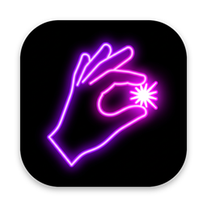
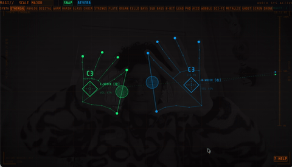

<h1>Neo Theremin</h1>

Play a browser-based synthesizer with your hands. 
Your webcam tracks each hand and turns movement into sound.

  
  
  

<a href="https://neo-theremin.vercel.app">Try it live</a>

Neo Theremin turns your webcam into an instrument you play in the air.

- Each hand plays its own voice: the gap between thumb and index sets pitch, height sets volume.
- Gestures add sustain, vibrato, filter sweeps and mute; opening your mouth sounds a siren.
- 21 synth packs, five scales and note snapping.

## How it works

Hand and face tracking run in the browser with [MediaPipe](https://ai.google.dev/edge/mediapipe), and the [Web Audio API](https://developer.mozilla.org/en-US/docs/Web/API/Web_Audio_API) makes the sound. The video isn't uploaded; the tracking models download from Google's servers when the page loads. The full gesture list is in [docs/gestures.md](docs/gestures.md).

## Install

Use it at [neo-theremin.vercel.app](https://neo-theremin.vercel.app), or run it locally with `npm install --legacy-peer-deps` and `npm run dev`. It needs a webcam; Chrome and Edge give the tracking the most reliable GPU path.

---

[MIT](LICENSE)

Made by [santiagoalonso.com](https://santiagoalonso.com)
